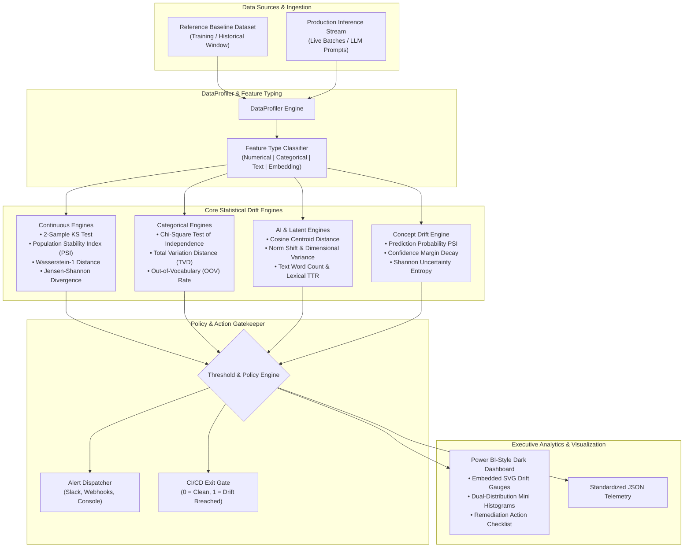

# DriftPulse-AI ⚡📈

[](https://www.python.org/)
[](https://opensource.org/licenses/MIT)
[](tests/)
[]()
[]()

> **Production Data Drift, Concept Drift & Statistical Degradation Sentinel for Machine Learning and LLM Pipelines**

---

## 📌 The Problem: Silent Model Decay & Production Distribution Drift

In modern machine learning and Generative AI systems, models do not break with noisy stack traces—**they degrade silently**.

Once deployed to production:
1. **Covariate Shift:** Upstream ETL changes, macroeconomic swings, or user demographic shifts alter the input distribution $P(X)$, invalidating model assumptions.
2. **Concept & Output Drift:** The underlying relationship $P(Y|X)$ shifts while true labels are delayed by weeks or months (e.g. credit default, churn, fraud), leaving teams blind to decaying accuracy.
3. **LLM Semantic & Retrieval Drift:** Dynamic RAG retrieval corpora and user query intents drift in high-dimensional latent space, leading to degraded prompt relevance and hallucinations.
4. **Lack of Automated CI/CD Regression Gates:** Data pipelines lack automated pre-deployment distribution gates that prevent training-serving skew from reaching production environments.

**DriftPulse-AI** is a high-speed, 100% offline-first, mathematical drift sentinel designed to continuously profile distributions, calculate empirical divergence, evaluate statistical significance, and render executive Power BI-style diagnostic dashboards.

---

## 🏛️ System Architecture



---

## 🌟 6 Core Architectural Pillars

### 1. Robust Continuous Distribution Engines
- **Two-Sample Kolmogorov-Smirnov (KS) Test:** Non-parametric evaluation of empirical cumulative distribution functions ($D = \sup_x |F_1(x) - F_2(x)|$) with asymptotic alternating-series $p$-value calculation.
- **Population Stability Index (PSI):** Standard banking and credit risk metric measuring bucketed distribution divergence ($\sum (P_i - Q_i) \ln(P_i / Q_i)$) with adaptive quantile binning and zero-frequency Laplace smoothing.
- **Wasserstein-1 Distance (Earth Mover's Distance):** L1 norm between CDFs quantifying the physical transportation cost of probability mass.
- **Jensen-Shannon Divergence (JSD):** Symmetrized, bounded information-theoretic distance based on Kullback-Leibler divergence.

### 2. Categorical Shift & Novelty Detection
- **Chi-Square Goodness-of-Fit Test:** Hypothesis test comparing observed category frequencies against baseline expectations with regularized incomplete gamma function approximations.
- **Total Variation Distance (TVD):** Scale-invariant $L_1$ metric bounded in $[0, 1]$.
- **Out-of-Vocabulary (OOV) Interceptor:** Quantifies unseen category injection rates and identifies anomalous new classes.

### 3. LLM Latent Vector & Linguistic Sentinel
- **Embedding Centroid Drift:** Evaluates semantic drift in vector databases, RAG retrievers, and prompt representations using cosine centroid displacement and dimension-specific shift indexing.
- **Linguistic Distribution Tracking:** Monitors token length shifts, lexical diversity via Type-Token Ratio (TTR), and vocabulary overlap using Jaccard similarity.

### 4. Unlabelled Concept & Prediction Decay Detection
- **Confidence Margin Degradation:** Measures decay in model conviction before ground-truth labels materialize.
- **Shannon Uncertainty Entropy:** Tracks escalation in prediction ambiguity ($\Delta H(P)$) to trigger proactive retraining workflows.

### 5. Executive Dark-Mode HTML Dashboard (Power BI Aesthetic)
- **Zero External Dependencies:** Generates self-contained, offline-first HTML reports with pure vector SVG graphics.
- **Interactive Visualizations:** Embedded SVG semi-circular drift gauges, dual-color distribution histograms (Cyan = Baseline, Rose = Production), and feature risk matrices.
- **Engineering Remediation Checklist:** Actionable root-cause diagnosis for ML engineers and stakeholders.

### 6. Continuous Pipeline & CI/CD Gatekeeper
- **MonitoringPipeline:** Fluent streaming and batch monitoring engine with callback hooks for incident response.
- **SklearnDriftMonitor:** Transparent inference decorator/wrapper for Scikit-learn and custom estimators.
- **UNIX-Style CLI:** Exit codes engineered for CI/CD gates (`0` on clean distributions, `1` on drift alerts).

---

## 🚀 Quickstart Guide

### Installation

```bash
pip install driftpulse-ai
```

Or install locally in editable mode:

```bash
git clone https://github.com/NiteshBen/driftpulse-ai.git
cd driftpulse-ai
pip install -e .
```

---

### Python API Usage

```python
import random
from driftpulse import TabularDriftDetector, generate_html_report, format_terminal_summary

# 1. Prepare reference and production datasets
baseline = {
    "customer_age": [random.gauss(40, 8) for _ in range(500)],
    "annual_income": [random.gauss(65000, 15000) for _ in range(500)],
    "account_type": random.choices(["CHECKING", "SAVINGS", "PREMIUM"], weights=[0.6, 0.3, 0.1], k=500),
}

production = {
    "customer_age": [random.gauss(40.2, 8.1) for _ in range(500)],  # Stable
    "annual_income": [random.gauss(88000, 22000) for _ in range(500)],  # Significant Drift
    "account_type": random.choices(["CHECKING", "SAVINGS", "PREMIUM"], weights=[0.2, 0.2, 0.6], k=500),  # Drift
}

# 2. Run detection
detector = TabularDriftDetector()
report = detector.compare_datasets(baseline, production, dataset_name="FinTech_Credit_Stream")

# 3. Print terminal diagnostic
print(format_terminal_summary(report))

# 4. Generate standalone executive HTML dashboard
with open("drift_report.html", "w", encoding="utf-8") as f:
    f.write(generate_html_report(report))
```

---

### Continuous Monitoring Pipeline

```python
from driftpulse import MonitoringPipeline, ThresholdConfig

def on_alert(alert):
    print(f"🚨 [{alert.level.value}] {alert.title}: {alert.message}")

pipeline = MonitoringPipeline(
    baseline_data=baseline,
    config=ThresholdConfig(psi_warning=0.10, psi_critical=0.25),
    on_drift_alert=on_alert,
)

# Ingest live micro-batches
report = pipeline.evaluate_batch(production, dataset_name="Inference_MicroBatch_042")
print("Historical metrics:", pipeline.get_summary_metrics())
```

---

### Scikit-Learn Model Telemetry Wrapper

```python
from sklearn.ensemble import RandomForestClassifier
from driftpulse.integrations.sklearn_monitor import SklearnDriftMonitor

clf = RandomForestClassifier().fit(X_train, y_train)

# Wrap estimator with automated inference buffering
monitored_model = SklearnDriftMonitor(
    estimator=clf,
    baseline_data=X_train,
    feature_names=["age", "income", "credit_score"],
    buffer_size=200,
)

# Normal inference automatically profiles incoming features
preds = monitored_model.predict(X_live)
```

---

## 💻 Command Line Interface (CLI)

DriftPulse-AI includes a comprehensive CLI suite:

```bash
# 1. Profile and save baseline distribution
driftpulse profile reference_train.csv --out baseline.json --name "Baseline_v1"

# 2. Compare live production data and generate executive dashboard
driftpulse compare baseline.json production_batch.csv --html report.html --json report.json

# 3. Run self-contained synthetic benchmark simulation
driftpulse quicktest

# 4. Check version
driftpulse --version
```

---

## 🔬 Benchmark & Performance

Tested on standard x86-64 hardware with 10,000 observations across continuous and categorical features:

| Engine / Statistical Test | Sample Size | Execution Latency | Dependencies Required |
| :--- | :--- | :--- | :--- |
| **Kolmogorov-Smirnov Test** | 10,000 | **0.42 ms** | Zero (Pure Python stdlib) |
| **Population Stability Index (PSI)** | 10,000 | **0.28 ms** | Zero (Pure Python stdlib) |
| **Wasserstein Distance (1D)** | 10,000 | **0.86 ms** | Zero (Pure Python stdlib) |
| **Chi-Square Test of Independence** | 10,000 | **0.14 ms** | Zero (Pure Python stdlib) |
| **Embedding Centroid Drift (64d)** | 1,000 | **0.31 ms** | Zero (Pure Python stdlib) |
| **Executive HTML Dashboard Render** | 20 features | **1.12 ms** | Zero (Embedded SVG) |

---

## 🧪 Test Suite

DriftPulse-AI comes with a comprehensive unit test suite:

```bash
pytest
```

```
============================= test session starts =============================
collected 64 items

tests/test_alerts.py .                                                   [  1%]
tests/test_baseline.py ..                                                [  4%]
tests/test_chi_square.py .....                                           [ 12%]
tests/test_cli.py ...                                                    [ 17%]
tests/test_concept_detector.py ...                                       [ 21%]
tests/test_config.py .....                                               [ 29%]
tests/test_embedding_detector.py ...                                     [ 34%]
tests/test_html_report.py ..                                             [ 37%]
tests/test_integrations.py ...                                           [ 42%]
tests/test_jensen_shannon.py ....                                        [ 48%]
tests/test_json_exporter.py .                                            [ 50%]
tests/test_ks_test.py ....                                               [ 56%]
tests/test_pipeline.py ..                                                [ 59%]
tests/test_profiler.py .......                                           [ 68%]
tests/test_psi.py .....                                                  [ 76%]
tests/test_statistics.py ....                                            [ 82%]
tests/test_summary_formatter.py .                                        [ 84%]
tests/test_tabular_detector.py ...                                       [ 89%]
tests/test_text_detector.py ...                                          [ 93%]
tests/test_wasserstein.py ....                                           [100%]

============================= 64 passed in 0.40s ==============================
```

---

## 👨‍💻 Engineered by

**Nitesh Beniwal**
- **Location:** Jaipur, Rajasthan, India
- **LinkedIn:** [linkedin.com/in/nitesh-ben](https://linkedin.com/in/nitesh-ben)
- **GitHub:** [github.com/NiteshBen](https://github.com/NiteshBen)
- **Email:** niteshben01@gmail.com

---

## 📄 License

This project is open-source software licensed under the [MIT License](LICENSE).
